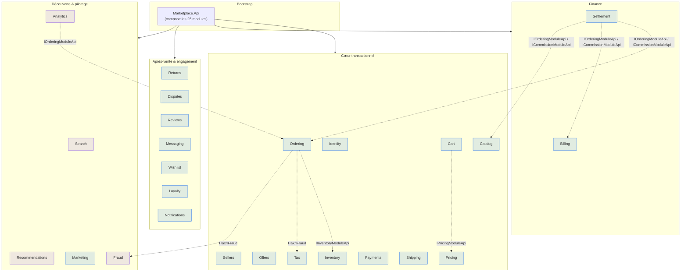
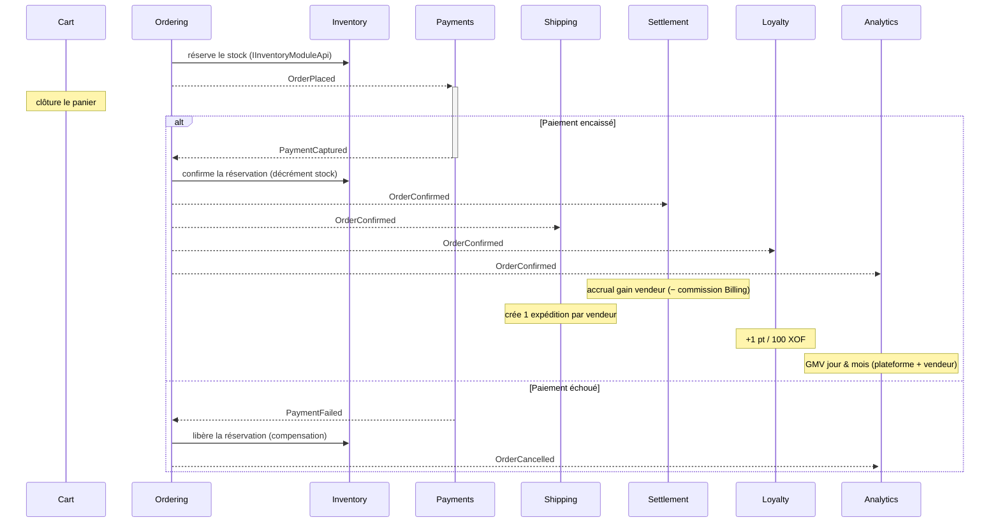
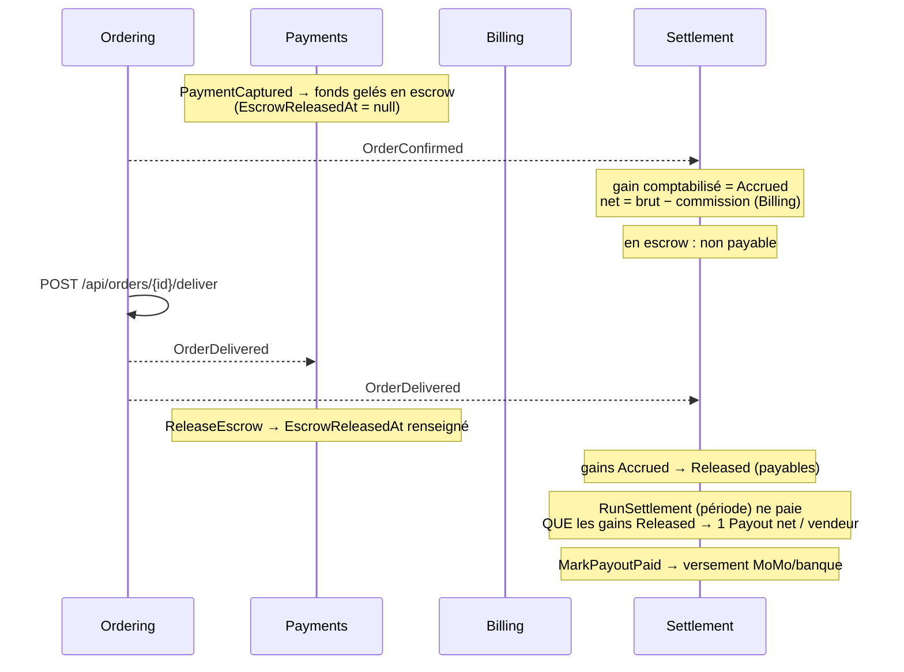
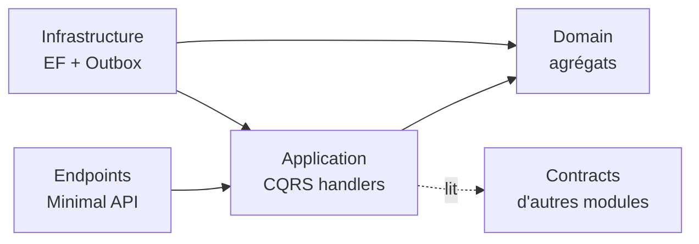

# Marketplace — Monolithe modulaire (.NET 8)

Marketplace multi-vendeur pour le marché ouest-africain (Bénin en premier lieu). Le backend est un **monolithe modulaire** : un seul artefact de déploiement, découpé en **25 modules** aux frontières strictes. Chaque module est une tranche verticale (domaine, application, persistance et schéma PostgreSQL propres). Les modules ne communiquent **jamais** en accédant à la base ou aux entités internes d'un autre — uniquement via des **contrats publics** (appel in-process) ou des **events d'intégration** (bus via Outbox). C'est ce qui rendrait une extraction future en microservices mécanique plutôt qu'une refonte.

## Stack

| Couche | Techno |
| --- | --- |
| Langage / runtime | C# / .NET 8 |
| Persistance | EF Core 8 + PostgreSQL (Npgsql), **un schéma par module** |
| CQRS in-process | MediatR — pipeline Logging + Validation |
| Fiabilité des events | **Outbox pattern** (bus in-process aujourd'hui → Kafka demain, même contrat) |
| Gestion d'erreurs | **Result pattern** (`Result`/`Result<T>` + `Error`), pas d'exceptions de contrôle de flux |
| Validation | FluentValidation |
| API | ASP.NET Core Minimal API + Swagger, auth JWT (émis par Identity) |
| Tests | xUnit, FluentAssertions, **NetArchTest** (frontières), **Testcontainers** (intégration) |

## Les 25 modules par contexte

| Contexte | Modules |
| --- | --- |
| **Identité & vendeurs** | `Identity` (JWT, rôles, MFA, vérif e-mail) · `Sellers` (onboarding, KYB) |
| **Catalogue & offres** | `Catalog` (produits, variantes, médias, marques, catégories) · `Offers` (pont produit×vendeur : prix, condition, fulfillment) · `Inventory` (stock SKU/lieu, réservations) |
| **Prix & promotions** | `Pricing` (promotions, calcul du prix final par financeur) · `Tax` (règles de TVA par juridiction/catégorie) |
| **Achat** | `Cart` (panier, valorisation via Pricing) · `Ordering` (commande multi-vendeur, **Saga**) |
| **Paiement & logistique** | `Payments` (capture/échec/remboursement) · `Shipping` (expéditions par vendeur) |
| **Finance plateforme** | `Billing` (règles de commission, factures) · `Settlement` (grand livre des gains, lots de reversement/payout) |
| **Après-vente** | `Returns` (RMA) · `Disputes` (litiges/réclamations) |
| **Engagement** | `Reviews` (notes + modération) · `Messaging` (chat acheteur↔vendeur) · `Wishlist` · `Loyalty` (points, paliers Bronze/Silver/Gold) · `Notifications` (fan-out multi-canal) |
| **Découverte & pilotage** | `Search` (read model) · `Recommendations` (read model) · `Analytics` (reporting GMV) · `Marketing` (campagnes + CMS) · `Fraud` (scoring de risque) |

## Carte des modules



Trait plein = exposé par l'API ; trait pointillé = appel in-process via le projet `Contracts` du module cible (jamais sa base). Les modules violets sont des **read models / scoring** alimentés par les events.

## La Saga de commande (chorégraphie par events)

Le cycle de vie d'une commande est piloté par une **Saga chorégraphiée** : aucun orchestrateur central, chaque module réagit à un event d'intégration et publie le sien via son Outbox. Compensation incluse (échec paiement → libération du stock).



## Le cycle financier complet (escrow → payout)

Sur une marketplace, on n'encaisse pas pour soi : les fonds du vendeur sont **gelés en escrow** à l'encaissement et ne lui sont reversés qu'à la **livraison confirmée**. Le module Payments tient l'escrow ; Settlement tient le grand livre des gains et produit les reversements ; la livraison est le déclencheur unique (`OrderDelivered`).



États d'un gain vendeur (`SellerEarning`) : **Accrued** (confirmé, en escrow) → **Released** (livré, escrow levé, payable) → **Settled** (inclus dans un lot de payout) ; **Reversed** couvre retours/remboursements. Le calcul du net (brut − commission) trace chaque financeur de réduction : une remise financée par le vendeur diminue son revenu, une remise plateforme est absorbée par la plateforme — base d'un payout auditable.

> **Granularité multi-vendeur** — deux déclencheurs coexistent : `OrderDelivered` (commande entière) libère l'escrow du paiement et tous les gains restants ; et `ShipmentDelivered` (par vendeur, émis par Shipping avec le `SellerId`) libère **les gains de ce vendeur dès que SA propre expédition est livrée**, sans attendre les autres vendeurs. Chaque vendeur est ainsi payé au rythme de ses livraisons.

## Mécanique transverse (BuildingBlocks)

- **Result pattern** — les handlers renvoient `Result`/`Result<T>` ; les endpoints mappent `Error.Type` vers le code HTTP (`Validation`→400, `NotFound`→404, `Conflict`→409…). Pas d'exceptions pour le contrôle de flux.
- **Domain events → Integration events** — un agrégat lève un *domain event* ; à `SaveChangesAsync`, le `ModuleDbContext` les dispatche, et les *integration events* mis en file sont écrits dans la table **outbox du module, dans la même transaction**.
- **Outbox** — un `OutboxProcessor<TDbContext>` par module poll les messages non traités et les passe à l'`IntegrationEventDispatcher`, qui résout `IIntegrationEventHandler<T>` en DI (bus en mémoire). Demain, le même contrat est rempli par un consumer Kafka sans toucher au métier.
- **Module API** — chaque besoin de lecture synchrone inter-module passe par une interface `IXxxModuleApi` du projet `Contracts` (ex. `IOrderingModuleApi`, `ICommissionModuleApi`, `ITaxModuleApi`, `IFraudModuleApi`).
- **Composition** — `ModuleRegistry.Installers` est la **source unique** des modules ; `Program.cs` exécute chaque `IModuleInstaller`, enregistre MediatR sur toutes les assemblies Application, puis branche pipeline + infrastructure.

## La règle des dépendances (vérifiée par NetArchTest)

```
Domain         -> rien (sauf BuildingBlocks.Domain)
Application    -> Domain (+ Contracts d'autres modules)
Infrastructure -> Application + Domain
Contracts      -> rien d'interne (DTOs / events / interfaces purs)

INTERDIT : Ordering.Application --X--> Catalog.Domain        (ni EF Core dans Domain/Application)
AUTORISÉ : Ordering.Application --OK--> Catalog.Contracts
```

`Architecture.Tests` fait **échouer le build** si un module en référence un autre illégalement, ou si une couche Domain/Application dépend d'EF Core. C'est le garde-fou contre la dérive vers le monolithe spaghetti.

## Structure de la solution

```
Marketplace.sln
├── src/
│   ├── Bootstrap/Marketplace.Api/        <- SEUL point de déploiement ; ModuleRegistry
│   ├── Modules/<Module>/                 <- 25 modules, 4 projets chacun :
│   │     ...<Module>.Domain              entités, VOs, domain events
│   │     ...<Module>.Application          commands/queries, handlers, validators
│   │     ...<Module>.Infrastructure       EF Core, repositories, outbox, migration, DI
│   │     ...<Module>.Contracts            <- SEUL projet référençable de l'extérieur
│   └── BuildingBlocks/                    Domain · Application · Infrastructure · IntegrationEvents
└── tests/
    ├── <Module>.UnitTests/                (un par module)
    ├── Catalog.IntegrationTests/          persistance + outbox sur vrai PostgreSQL
    ├── Saga.IntegrationTests/             composition des 25 modules + Saga commande
    └── Architecture.Tests/                frontières (NetArchTest)
```

## Démarrer

Prérequis : SDK .NET 8, un PostgreSQL accessible, et **Docker** pour les tests d'intégration (Testcontainers).

```bash
dotnet build                       # restaurer + compiler la solution

dotnet test                        # unitaires + architecture + intégration (Docker requis)

dotnet run --project src/Bootstrap/Marketplace.Api   # lancer l'API + Swagger
```

La chaîne de connexion se règle via `ConnectionStrings:Marketplace` (`appsettings.json`). Au démarrage, mettre `RunMigrationsAtStartup: true` applique automatiquement les migrations des 25 schémas ; sinon, appliquer par module :

```bash
dotnet ef database update \
  --project src/Modules/Catalog/Marketplace.Modules.Catalog.Infrastructure \
  --startup-project src/Bootstrap/Marketplace.Api
```

> **Sécurité** — `Jwt:SigningKey` dans `appsettings.json` est un **placeholder** : le remplacer par un secret réel (variable d'environnement / coffre) avant tout déploiement.

## Ajouter un nouveau module

Chaque module reproduit le même patron : 4 projets (`Domain`, `Application`, `Infrastructure`, `Contracts`) en Clean Architecture, un **schéma PostgreSQL dédié**, un `IModuleInstaller` ajouté à `ModuleRegistry.Installers`, sa table outbox + un `OutboxProcessor`, et une communication vers l'extérieur uniquement via `Contracts` (appel in-process) ou les `IntegrationEvents` (bus). Le test `FullCompositionTests` migre alors automatiquement le nouveau schéma et vérifie que le graphe DI compose.

## État

**25 / 25 modules** du dossier d'architecture livrés en tranches verticales complètes (Domain → endpoints), avec tests unitaires, tests de frontière, et tests d'intégration de la Saga. Migrations EF écrites à la main (un schéma par module). Bus d'events in-process prêt à être remplacé par Kafka sans impact sur le code métier.

