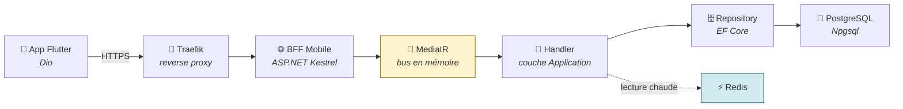
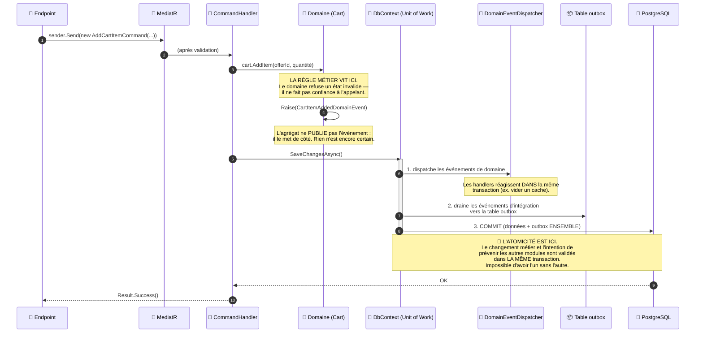

# 12 — Anatomie d'une requête : du doigt de l'utilisateur à PostgreSQL, et retour

> **À qui s'adresse ce document.**
> À quelqu'un qui n'a jamais vu MediatR, CQRS, ni EF Core, et qui vient de récupérer ce
> dépôt. On suit **une seule requête**, de bout en bout, en nommant chaque technologie
> traversée et en expliquant **à quoi elle sert** — et, plus important, **pourquoi elle
> est là**.
>
> Si vous ne devez retenir qu'une chose : entre le contrôleur HTTP et la base de données,
> il n'y a **aucun appel direct**. Tout passe par un **message**. C'est déroutant au
> début, et c'est le cœur de l'architecture.

---

## 0. La carte, avant le voyage



Neuf technologies. Aucune n'est là par goût : chacune résout un problème précis. On va
les rencontrer dans l'ordre.

---

## 1. Le voyage aller — lire une fiche produit

Prenons le geste le plus banal de l'application : **un acheteur ouvre une fiche produit**.

```mermaid
sequenceDiagram
    autonumber
    actor U as 👤 Acheteur
    participant F as 📱 Flutter (Dio)
    participant T as 🚦 Traefik
    participant K as 🌐 Kestrel + middlewares
    participant EP as 📍 Endpoint (Minimal API)
    participant M as 📨 ISender (MediatR)
    participant B as 🔗 Behaviors
    participant H as 🧠 QueryHandler
    participant C as ⚡ Redis
    participant R as 🗄️ Repository (EF Core)
    participant P as 🐘 PostgreSQL

    U->>F: tape sur un produit
    F->>T: GET /mobile/products/{id}<br/>Authorization: Bearer eyJ…
    Note over F,T: Dio = client HTTP de Flutter.<br/>Il ajoute le jeton JWT à chaque appel.

    T->>K: route vers le conteneur bff-mobile
    Note over T: Traefik termine le TLS et choisit<br/>le bon service. Il ne comprend rien au métier.

    K->>K: CORS → Auth (JWT) → RateLimiter
    Note over K: Le JWT est VÉRIFIÉ ici, pas dans le code métier.<br/>Un jeton invalide n'atteint jamais un handler.

    K->>EP: appelle ProductDetailAsync(id, …)
    Note over EP: L'endpoint ne contient AUCUNE logique métier.<br/>Il traduit HTTP → message, et c'est tout.

    EP->>M: sender.Send(new GetProductQuery(id))
    Note over M: 🔑 LE POINT CLÉ.<br/>L'endpoint ne CONNAÎT PAS le handler.<br/>Il poste un message ; MediatR trouve le destinataire.

    M->>B: le message traverse le pipeline
    B->>B: LoggingBehavior (trace)
    B->>B: ValidationBehavior (FluentValidation)
    Note over B: Si la validation échoue, le handler<br/>n'est JAMAIS appelé. Court-circuit.

    B->>H: GetProductQueryHandler.Handle(query)

    H->>C: cache.GetOrCreateAsync("catalog:product:{id}")
    alt Cache CHAUD (cas le plus fréquent)
        C-->>H: ProductSummary (≈1 ms)
        Note over C,H: La base n'est jamais touchée.
    else Cache FROID
        C->>R: exécute la « factory »
        R->>P: SELECT … FROM catalog.products WHERE id = $1
        Note over R,P: EF Core traduit le C# en SQL.<br/>Npgsql parle le protocole Postgres.
        P-->>R: lignes
        R-->>H: entité Product (objet C#)
        H->>C: mémorise le résultat (TTL 5 min)
    end

    H-->>B: Result<ProductSummary>
    Note over H: ⚠️ PAS d'exception en cas d'échec métier.<br/>Un Result « échec » est une valeur de retour normale.

    B-->>EP: Result<ProductSummary>
    EP->>EP: result.Match(p => Results.Ok(p))
    Note over EP: Match traduit le Result en code HTTP :<br/>NotFound→404, Validation→400, Conflict→409…

    EP-->>K: 200 OK + JSON
    K-->>T: 200 OK
    T-->>F: 200 OK
    F->>F: ProductSummary.fromJson(...)
    F-->>U: la fiche s'affiche
```

---

## 2. Chaque technologie, et pourquoi elle est là

### Dio (Flutter) — le client HTTP

Il envoie la requête et **attache le jeton JWT** à chaque appel via un intercepteur. C'est
aussi lui qui, quand le serveur répond `401`, tente de rafraîchir la session.

### Traefik — le portier

Il termine le **TLS** (le HTTPS), lit le nom de domaine, et route vers le bon conteneur.
Il ne comprend rien au métier — et c'est voulu : c'est un aiguilleur, pas un cerveau.

### Kestrel et les middlewares — le sas de sécurité

Le serveur HTTP de .NET. Avant que la moindre ligne de code métier ne s'exécute, la
requête traverse une file de **middlewares** : CORS, authentification JWT, limitation de
débit.

> **Pourquoi c'est important :** un jeton invalide est rejeté **ici**. Aucun handler ne
> verra jamais une requête non authentifiée. La sécurité n'est pas répétée dans chaque
> fonction — elle est appliquée une fois, en amont.

### L'endpoint (Minimal API) — le traducteur

Regardez-en un : il fait **trois lignes**. Il lit l'URL, construit un message, l'envoie, et
traduit la réponse en code HTTP. **Aucune logique métier.** Si vous y voyez un `if` sur une
règle de gestion, c'est un bug de conception.

### MediatR et `ISender` — le bureau de poste

**C'est la pièce la plus déroutante pour qui arrive.** Ceci :

```csharp
var result = await sender.Send(new GetProductQuery(id), ct);
```

…ne dit **pas** *qui* va traiter la requête. L'endpoint poste une **enveloppe**
(`GetProductQuery`). MediatR cherche dans le conteneur d'injection de dépendances la classe
qui sait ouvrir ce type d'enveloppe (`GetProductQueryHandler`), et la lui remet.

**Pourquoi s'infliger ça ?** Trois raisons, toutes concrètes :

1. **L'endpoint ne dépend d'aucun module.** Le BFF Mobile ne référence pas le module
   Catalog : il ne connaît que le *message*. On peut réécrire tout le module sans toucher
   au BFF.
2. **Le pipeline devient possible.** Comme tout passe par un point unique, on peut insérer
   du code **avant et après chaque handler** — validation, journalisation, mesure — sans le
   recopier partout. Voir ci-dessous.
3. **Le handler se teste seul.** Pas besoin de démarrer un serveur HTTP pour tester une
   règle métier : on instancie le handler et on lui passe un message.

> **Le piège à connaître.** MediatR résout les handlers **paresseusement**, à l'exécution.
> Un handler mal enregistré dans l'injection de dépendances **ne provoque aucune erreur au
> démarrage** — l'application se lance, l'air en pleine forme, et explose en `500` à la
> première utilisation de la fonctionnalité. Nous en avons déjà fait les frais.

### Les behaviors — les douanes du pipeline

Un `IPipelineBehavior` est une couche qui enveloppe **tous** les handlers. Elles s'exécutent
comme des poupées russes :

```
LoggingBehavior
   └─ ValidationBehavior
         └─ ← LE HANDLER
```

- **`ValidationBehavior`** exécute les règles FluentValidation associées au message. Si
  elles échouent, il **court-circuite** : le handler n'est jamais appelé, et un `Result`
  d'échec est renvoyé. C'est pour cela qu'aucun handler ne commence par vérifier que ses
  champs ne sont pas vides — c'est déjà fait.
- **`LoggingBehavior`** trace l'entrée, la sortie et la durée. Gratuitement, pour tous.

### Le handler — le seul endroit où le métier existe

C'est **ici**, et nulle part ailleurs, que se prennent les décisions. Le handler orchestre :
il lit le cache, appelle un repository, applique une règle du domaine, et renvoie un
`Result`.

### Le pattern `Result` — l'échec n'est pas une exception

```csharp
if (product is null)
{
    return Error.NotFound("catalog.product.not_found", "Produit introuvable.");
}
```

Un produit introuvable **n'est pas une anomalie** : c'est un cas de figure prévu. Le
signaler par une exception reviendrait à utiliser un dispositif de panique pour une
situation ordinaire — c'est coûteux, et cela mélange les vraies pannes (base de données
inaccessible) avec les cas métier normaux.

`Result` rend l'échec **visible dans la signature** : impossible de l'ignorer par distraction.

### `Match` — le seul endroit qui connaît HTTP

```csharp
return result.Match(p => Results.Ok(p));
```

`Match` traduit l'`Error` en code HTTP (`Validation`→400, `NotFound`→404, `Conflict`→409,
`Unauthorized`→401…). Le métier ne sait **rien** de HTTP, et c'est ce qui permettrait de
l'exposer un jour en gRPC ou en message queue sans rien réécrire.

### EF Core et Npgsql — le traducteur SQL

**EF Core** est l'ORM : il transforme du C# (`.Where(p => p.Id == id)`) en SQL. **Npgsql**
est le pilote qui parle le protocole binaire de PostgreSQL.

Chaque module a **son propre `DbContext`** et **son propre schéma** Postgres (`catalog.*`,
`orders.*`…). **Aucune jointure entre schémas.** C'est cette discipline qui permettrait
d'extraire un module en microservice un jour — et qui, en attendant, empêche le couplage
accidentel.

### Redis — la mémoire courte

Le catalogue est lu des millions de fois et modifié quelques fois par jour. Redis mémorise
les réponses pour éviter de recalculer sans cesse la même chose.

> **Le cache échoue OUVERT** : si Redis tombe, on retombe sur la base de données.
> L'application ralentit, elle ne s'arrête pas. Un cache qui ferait tomber le site en
> tombant aurait *réduit* la disponibilité — ce serait absurde.

---

## 3. Le voyage retour — écrire (et pourquoi c'est différent)

Une **écriture** ne fait pas que traverser les couches : elle déclenche des **conséquences**
dans d'autres modules. Voici l'ajout au panier, dans toute sa vérité.



### Pourquoi l'outbox ? Le problème des deux écritures

Imaginez qu'on publie l'événement **directement**, sans outbox :

```
1. COMMIT en base       ✅ réussi
2. Publier l'événement  ❌ le processus meurt ici
```

La commande existe, mais **personne n'en est informé** : le vendeur n'est pas prévenu, le
stock n'est pas décrémenté, le paiement n'est pas déclenché. La donnée est cohérente,
l'entreprise ne l'est pas.

L'inverse est pire encore : publier d'abord, puis échouer le commit — et l'on prévient tout
le monde d'une commande **qui n'existe pas**.

**L'outbox résout cela** en écrivant l'événement **dans la même table, dans la même
transaction** que la donnée métier. Soit les deux existent, soit aucun. Un processus de
fond (`OutboxProcessor`) relit ensuite cette table **toutes les 5 secondes**, par lots de
50, et publie les événements.

> **Le prix à payer, à connaître :** la propagation n'est pas instantanée. Elle est
> **garantie**, mais elle peut prendre quelques secondes. C'est le compromis de la
> *cohérence à terme* — et pour une marketplace, c'est le bon.

---

## 4. Récapitulatif — qui fait quoi

| Couche | Technologie | Sa seule responsabilité | Ce qu'elle ne doit **jamais** faire |
|---|---|---|---|
| Client | Flutter + Dio | Afficher, appeler l'API | Contenir une règle métier |
| Bordure | Traefik | TLS, routage | Comprendre le métier |
| Hôte | Kestrel + middlewares | Sécurité, débit, CORS | Décider d'une règle de gestion |
| Endpoint | Minimal API | HTTP → message → HTTP | Parler à la base de données |
| Bus | MediatR (`ISender`) | Trouver le bon handler | Contenir du code |
| Pipeline | Behaviors | Valider, journaliser | Décider métier |
| Application | Handler | Orchestrer | Contenir les invariants |
| **Domaine** | C# pur | **Garantir les invariants** | Connaître HTTP, SQL, ou MediatR |
| Persistance | EF Core + Npgsql | Traduire en SQL | Décider quoi que ce soit |
| Cache | Redis | Accélérer | Faire autorité sur la vérité |
| Propagation | Outbox | Ne perdre aucun événement | Publier avant le commit |

---

## 5. L'erreur classique du nouvel arrivant

> *« Je veux ajouter une règle : refuser plus de 10 articles identiques dans un panier.
> Où je la mets ? »*

**Pas dans l'endpoint** (il serait contourné par tout autre appelant).
**Pas dans le handler** (elle serait perdue si un autre handler manipule le panier).

**Dans le domaine — `Cart.AddItem()`.** C'est le seul endroit qu'aucun chemin ne peut
contourner. Un agrégat qui protège ses invariants ne peut pas être mis dans un état
invalide, **même par un développeur pressé qui ne connaît pas la règle**.

C'est toute la raison d'être de cette architecture.

---

**Voir aussi :** [13-diagrammes-de-sequence.md](13-diagrammes-de-sequence.md) (les parcours
métier complets) · [14-communication-entre-modules.md](14-communication-entre-modules.md)
(comment 25 modules se parlent sans se coupler).
