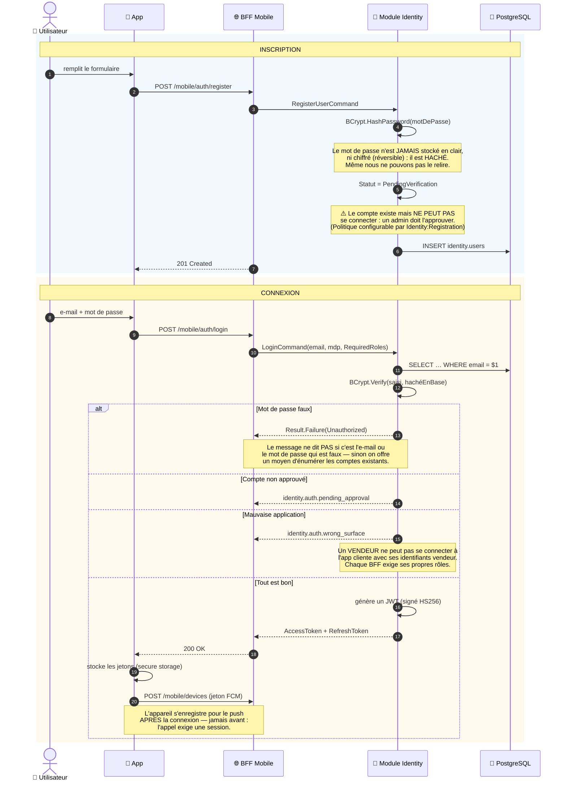
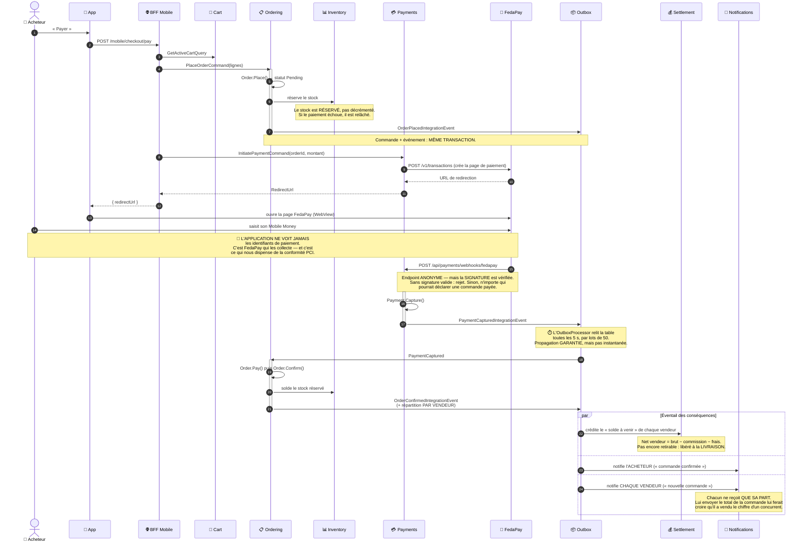
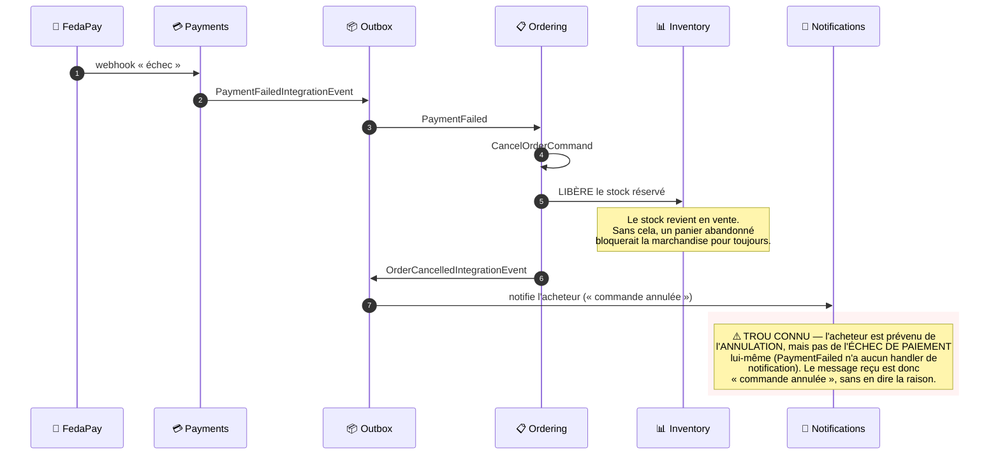
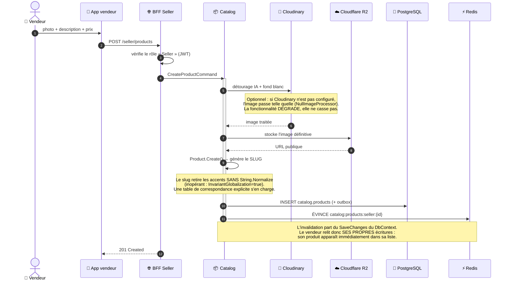
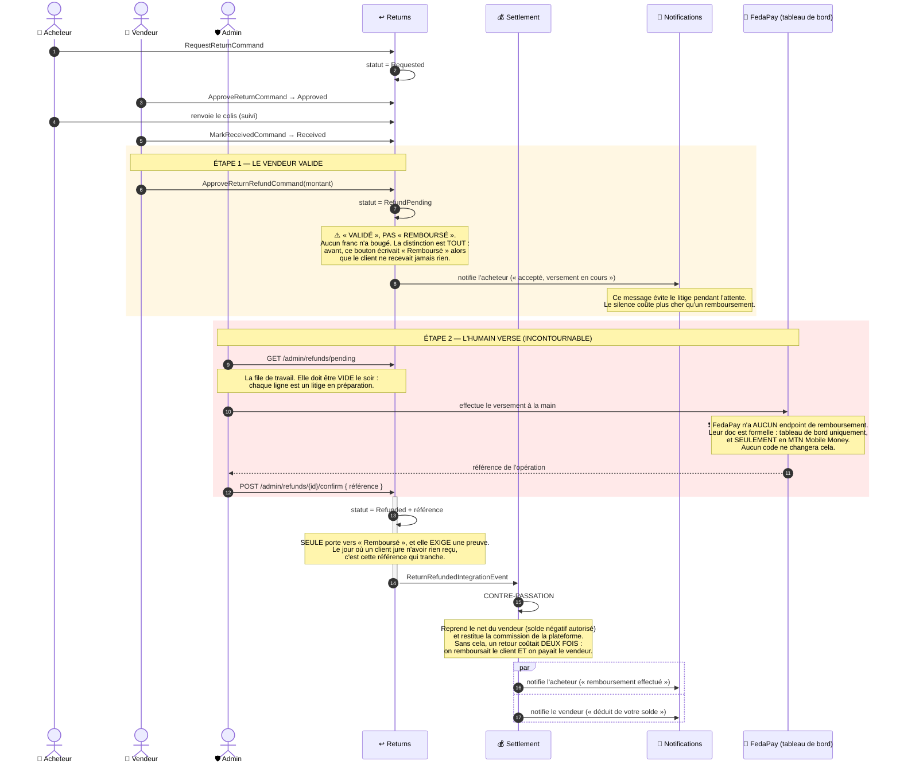
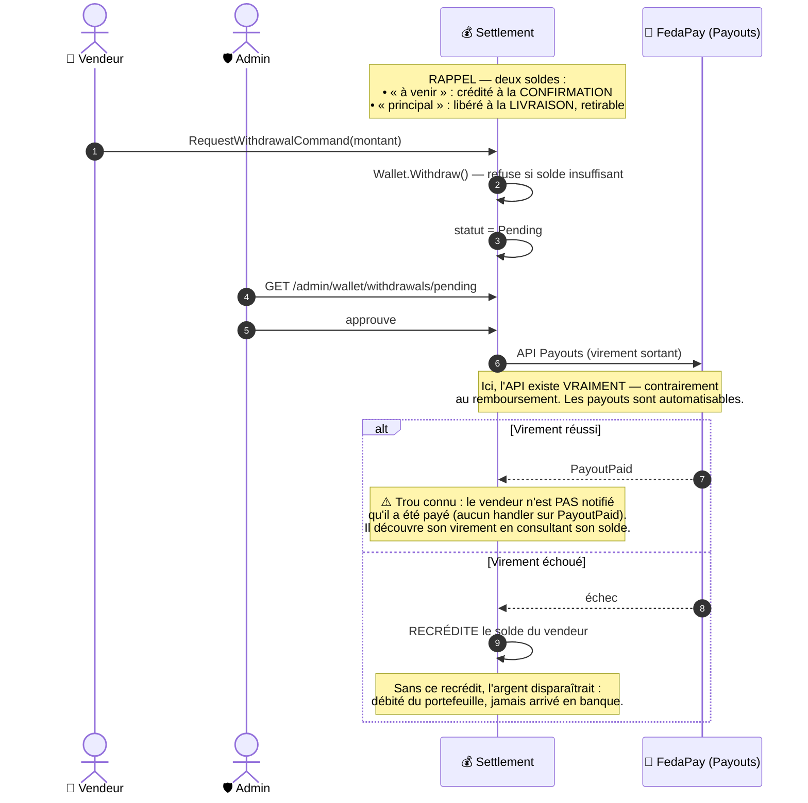

# 13 — Diagrammes de séquence des parcours principaux

> Ces diagrammes décrivent le code **tel qu'il est**, pas tel qu'on aimerait qu'il soit.
> Quand une étape est manuelle, un compromis ou une limite connue, c'est **dit**. Une
> documentation qui embellit est pire qu'une absence de documentation : elle fait perdre
> du temps à celui qui la croit.
>
> Prérequis : [12-anatomie-d-une-requete.md](12-anatomie-d-une-requete.md) explique
> MediatR, le pattern `Result` et l'outbox. Ici, on suppose ces notions acquises.

## Sommaire

1. [Inscription et connexion](#1-inscription-et-connexion)
2. [Consulter une fiche produit](#2-consulter-une-fiche-produit-le-chemin-le-plus-chaud)
3. [Du panier à la commande payée — **la saga**](#3-du-panier-à-la-commande-payée--la-saga)
4. [Le vendeur publie un produit](#4-le-vendeur-publie-un-produit)
5. [Retour et remboursement](#5-retour-et-remboursement)
6. [Retrait des gains du vendeur](#6-retrait-des-gains-du-vendeur)

---

## 1. Inscription et connexion



**Ce qu'il faut retenir.** Le JWT est signé avec une clé **partagée par les 5 hôtes** : un
jeton émis par le BFF Mobile est valide partout. C'est pratique — et c'est aussi pourquoi
chaque BFF **vérifie les rôles** en plus de la signature. Sans cela, un vendeur pourrait
utiliser son jeton sur l'API d'administration.

---

## 2. Consulter une fiche produit (le chemin le plus chaud)

C'est l'appel le plus fréquent de toute l'application. Il agrège **quatre modules** en une
seule réponse HTTP — c'est précisément le rôle d'un BFF.

```mermaid
sequenceDiagram
    autonumber
    participant A as 📱 App
    participant BFF as 🌐 BFF Mobile
    participant R as ⚡ Redis
    participant CAT as 📦 Catalog
    participant OFF as 💰 Offers
    participant SEL as 🏪 Sellers
    participant REV as ⭐ Reviews
    participant DB as 🐘 PostgreSQL

    A->>BFF: GET /mobile/products/{id}

    BFF->>CAT: catalog.GetProductAsync(id)
    CAT->>R: catalog:product:{id} ?
    alt cache chaud
        R-->>CAT: ProductSummary (≈1 ms)
    else cache froid
        CAT->>DB: SELECT catalog.products + variants + media
        CAT->>R: mémorise (TTL 5 min)
    end

    BFF->>OFF: offers.GetOffersByProductAsync(id)
    OFF->>R: offers:by-product:{id} ?
    Note over OFF,R: TTL 60 s SEULEMENT — ce module porte les PRIX.<br/>Un prix périmé n'est pas une lenteur,<br/>c'est une promesse qu'on ne tient pas.

    loop pour chaque vendeur du produit
        BFF->>SEL: sellers.GetSellerAsync(sellerId)
        SEL->>R: sellers:seller:{id} ?
        Note over BFF,SEL: ⚠️ Boucle N+1 — mais mise en cache (10 min).<br/>Sans le cache, c'était UNE REQUÊTE SQL PAR VENDEUR,<br/>et chacune chargeait ses documents KYB<br/>pour n'en garder que le nom de boutique.
    end

    BFF->>REV: GetProductRatingQuery(id)
    REV->>R: reviews:rating:{id} ?
    Note over REV: C'est une AGRÉGATION (moyenne sur tous les avis).<br/>Son coût grandit avec le succès du produit :<br/>les fiches les plus vues sont les plus chères à calculer.

    BFF-->>A: 200 OK — produit + offres + vendeurs + note
    Note over BFF,A: Un seul aller-retour réseau.<br/>Cache chaud : ZÉRO requête SQL.
```

> **Le sens du BFF.** Sans lui, l'application mobile ferait 4 à 6 appels HTTP et devrait
> savoir recoller les morceaux. Sur une connexion mobile béninoise, chaque aller-retour se
> paie. Le BFF fait le travail **une fois**, au plus près des données.

---

## 3. Du panier à la commande payée — **la saga**

C'est le parcours central, et le plus complexe. Il traverse **sept modules**, sans qu'aucun
ne connaisse les autres. Le lien entre eux, ce sont les **événements**.



### Et si le paiement échoue ?



---

## 4. Le vendeur publie un produit



---

## 5. Retour et remboursement

> **Lisez la note en rouge.** C'est le seul parcours de l'application où un **geste humain
> est indispensable**, et ce n'est pas un choix de conception : FedaPay **n'expose aucune
> API de remboursement**.



> **Une limite à connaître avant qu'un client ne la découvre :** FedaPay ne rembourse
> **qu'en MTN Mobile Money**. Un acheteur ayant payé par Moov n'est pas remboursable par ce
> canal — il faudra un autre moyen, et une décision.

---

## 6. Retrait des gains du vendeur



---

## Trous connus, rassemblés ici

Un développeur qui découvre le projet doit les connaître **avant** de les redécouvrir en
production :

| Événement | Ce qui manque | Conséquence concrète |
|---|---|---|
| `PaymentFailed` | Pas de **notification** (la commande est bien annulée) | Le client voit « commande annulée » sans en connaître la raison |
| `MessageSent` | Pas de **push** — la messagerie ne fait que du SignalR | Un message reçu app fermée n'alerte personne : la vente est perdue |
| `PayoutPaid` | Aucun handler | Le vendeur ne sait pas qu'il a été payé |
| `SellerActivated` | Aucun handler | Le vendeur ignore que sa boutique est validée ; il relance le support |
| `StockDepleted` | Aucun handler | Le vendeur ne sait pas qu'il est en rupture, et perd des ventes |
| `DisputeOpened` / `Resolved` | Aucun handler | Les litiges sont muets des deux côtés |

L'infrastructure de notification est **complète** : il ne manque que les handlers.
