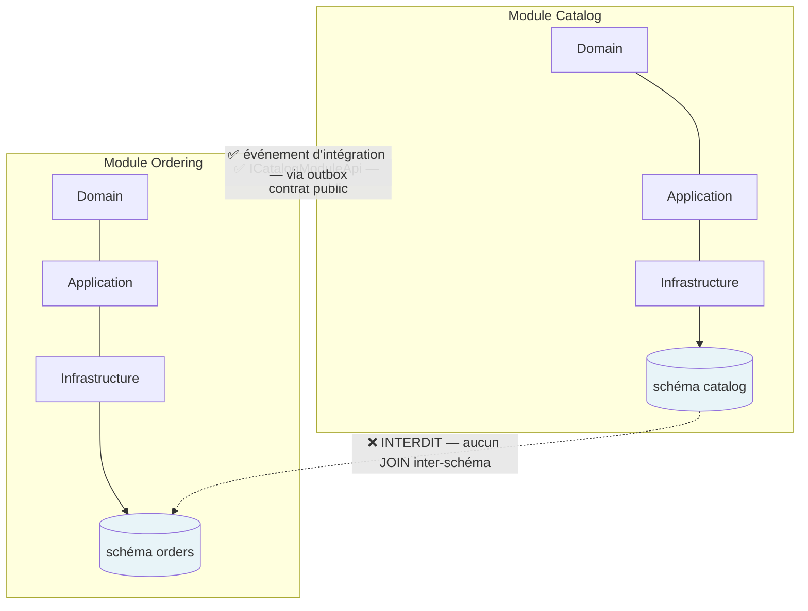
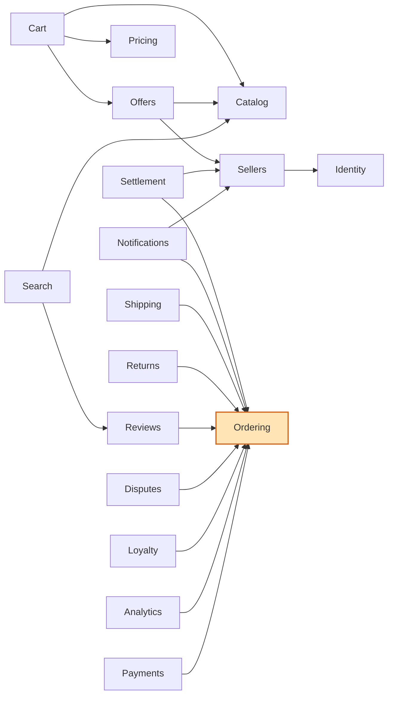
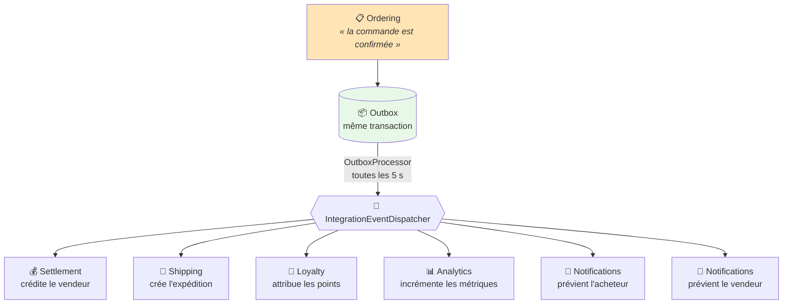
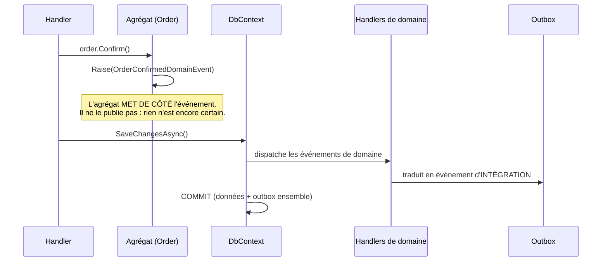
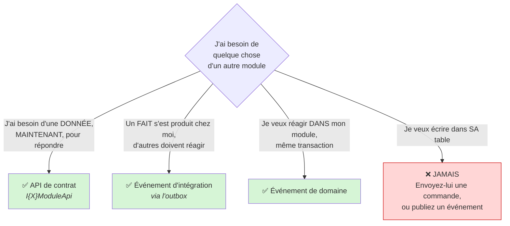

# 14 — Comment 25 modules se parlent sans se coupler

> **Le problème que ce document explique.**
>
> Vingt-cinq modules vivent dans **le même processus**, sur **la même base de données**.
> Rien, techniquement, n'empêche le module Ordering d'écrire un `JOIN` vers la table des
> produits. Ce serait plus court à écrire, plus rapide à exécuter, et cela détruirait
> l'architecture en une ligne.
>
> Ce document explique **les trois seuls canaux autorisés**, pourquoi cette discipline
> existe, et ce qu'elle vous coûte quand vous la respectez.

---

## 1. La règle d'or



> **Un module ne lit et n'écrit QUE dans son propre schéma PostgreSQL.**
> Pas de `JOIN` inter-schéma. Pas de clé étrangère inter-schéma. Jamais.

**Pourquoi s'imposer cela ?** Parce que le jour où un module doit devenir un service
séparé — parce qu'il devient trop chargé, ou trop critique —, l'opération est **mécanique**
si cette règle a été tenue, et **impossible** si elle a été violée une seule fois. Un `JOIN`
entre `orders` et `catalog` transforme deux modules indépendants en un seul bloc
inséparable. Et on ne s'en aperçoit que le jour où il est trop tard.

C'est une discipline **qui ne rapporte rien aujourd'hui** et qui sauve le projet dans deux
ans. C'est exactement pour cela qu'elle est si souvent abandonnée.

---

## 2. Les trois canaux

| # | Canal | Quand l'utiliser | Couplage | Latence |
|---|---|---|---|---|
| 1 | **API de contrat** (`I{X}ModuleApi`) | *« J'ai besoin de LIRE une donnée d'un autre module, tout de suite. »* | Faible (interface) | Immédiate |
| 2 | **Événement d'intégration** (outbox) | *« Il s'est passé quelque chose ; que ceux que ça concerne réagissent. »* | **Aucun** | ~5 secondes |
| 3 | **Événement de domaine** (interne) | *« Réagir DANS mon propre module, dans la même transaction. »* | Interne | Immédiate |

---

### Canal 1 — L'API de contrat : lire chez le voisin

Chaque module publie une **interface** dans son projet `Contracts` : c'est tout ce que les
autres ont le droit de voir de lui.

```csharp
// Contrats du module Catalog — la SEULE porte d'entrée
public interface ICatalogModuleApi
{
    Task<ProductSummary?> GetProductAsync(Guid productId, CancellationToken ct = default);
    Task<BrandSummary?>   GetBrandAsync(Guid brandId, CancellationToken ct = default);
    Task<CategorySummary?> GetCategoryAsync(Guid categoryId, CancellationToken ct = default);
}
```

Le module Cart injecte `ICatalogModuleApi` et appelle `GetProductAsync`. Il **ne voit ni
l'entité `Product`, ni le `DbContext`, ni la table**. Il ne voit qu'un DTO plat.

> **Ce que cela vous coûte, et pourquoi c'est le bon prix.**
> Vous ne pouvez pas faire une requête sur mesure chez le voisin. Vous prenez ce que son
> contrat expose, ou vous lui demandez d'enrichir son contrat — ce qui vous force à
> **justifier** le besoin. C'est une friction volontaire : elle empêche le couplage
> silencieux qui, autrement, s'installe sans que personne ne décide rien.

**Les dépendances réelles aujourd'hui** (extraites du code) :



> **`IOrderingModuleApi` est injecté par NEUF modules.** C'est le point le plus sollicité
> de l'architecture — normal pour une marketplace, où presque tout se rattache à une
> commande. C'est aussi le contrat à **modifier avec le plus de précaution** : une
> signature cassée ici casse neuf modules d'un coup.

---

### Canal 2 — L'événement d'intégration : le fait accompli

C'est le canal **le plus important**, et le plus contre-intuitif.

Quand une commande est confirmée, Ordering ne prévient personne. Il **déclare un fait** :

```csharp
await _publisher.PublishAsync(new OrderConfirmedIntegrationEvent { … }, ct);
```

Ordering **ne sait pas** qui écoute. Il ne sait pas que Settlement va créditer un vendeur,
que Shipping va créer une expédition, que Notifications va envoyer un push. Et il **ne doit
pas le savoir**.



**Six handlers** réagissent aujourd'hui à `OrderConfirmed`. Ordering n'en connaît aucun.

> **La conséquence pratique, et elle est belle :** ajouter une septième réaction — disons,
> envoyer une facture — ne demande **aucune modification** du module Ordering. On écrit un
> handler, on l'enregistre, c'est tout. Le module qui produit l'événement n'est pas touché.
>
> **La contrepartie, tout aussi réelle :** pour savoir « qui réagit quand une commande est
> confirmée ? », il faut chercher dans tout le dépôt. Le flux n'est plus lisible dans un
> seul fichier. C'est le prix du découplage, et il faut l'accepter en connaissance de cause.

#### L'outbox, en une phrase

L'événement est écrit **dans la même transaction** que la donnée métier. Soit les deux sont
validés, soit aucun. Il devient donc **impossible** d'avoir une commande confirmée dont
personne n'est informé — ou, pire, de prévenir tout le monde d'une commande qui n'a jamais
été enregistrée.

Un processus de fond relit la table **toutes les 5 secondes**, par lots de 50, et publie.

---

### Canal 3 — L'événement de domaine : rester chez soi

Interne au module, **synchrone**, dans la même transaction. L'agrégat le lève ; le
`DbContext` le dispatche au moment du `SaveChanges`.



**La traduction domaine → intégration est délibérée.** L'événement de domaine
(`OrderConfirmedDomainEvent`) appartient au modèle interne d'Ordering : il peut changer à
tout moment. L'événement d'intégration (`OrderConfirmedIntegrationEvent`) est un **contrat
public** : le modifier casse les autres modules. Les garder distincts, c'est se laisser le
droit de remanier son domaine sans faire tomber la moitié de l'application.

---

## 3. Quel canal choisir ? (l'arbre de décision)



### Le piège classique

> *« J'ai besoin que le stock baisse quand une commande est confirmée. J'appelle
> `InventoryDbContext` depuis Ordering ? »*

**Non.** Deux modules, deux schémas, deux transactions. Ordering **publie** que la commande
est confirmée ; Inventory **écoute** et décide seul de ce qu'il fait de son stock.

La différence n'est pas cosmétique : dans le premier cas, Ordering doit connaître les règles
de stock (et les casser un jour). Dans le second, **chaque module reste maître de ses
propres invariants**. C'est toute la promesse du monolithe modulaire — et c'est elle qui
permettra, si vous le voulez un jour, d'en extraire des microservices sans tout réécrire.

---

## 4. Ce que cette architecture ne vous donne pas

Par honnêteté, et pour que personne ne soit surpris :

- **La propagation prend quelques secondes.** Un vendeur ne voit pas sa commande apparaître
  dans la milliseconde. C'est de la *cohérence à terme*, pas de la cohérence immédiate.
- **Le flux n'est pas lisible d'un seul coup d'œil.** Pour comprendre ce que déclenche une
  commande confirmée, il faut chercher les handlers. Aucun fichier ne raconte l'histoire
  complète — c'est pour cela que le diagramme du
  [document 13](13-diagrammes-de-sequence.md) existe.
- **Une erreur d'enregistrement dans l'injection de dépendances ne se voit pas au
  démarrage.** MediatR résout les handlers paresseusement : l'application démarre
  parfaitement, et échoue en `500` à la première utilisation. C'est déjà arrivé.

Ces trois coûts sont réels. Ils sont le prix de modules qui peuvent évoluer, être testés, et
un jour être séparés — sans que le projet devienne un bloc que plus personne n'ose toucher.
